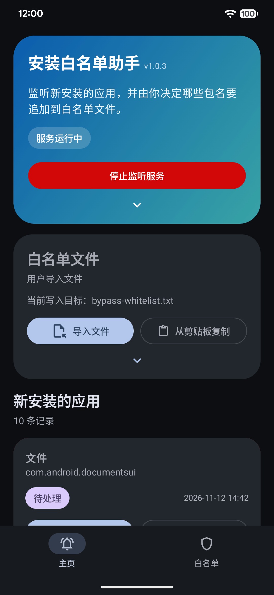
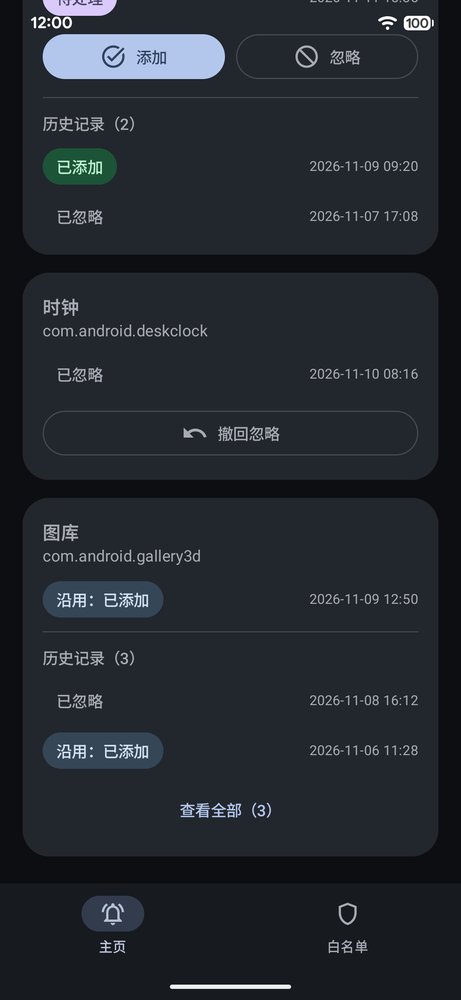
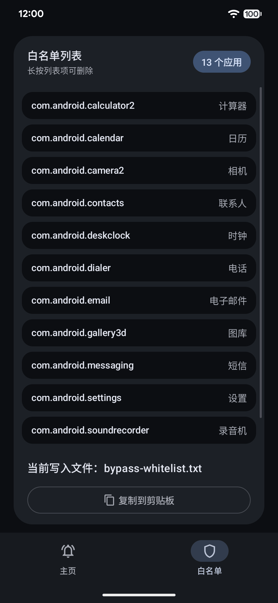

# Whitelist Maker

Whitelist Maker 是一款 Android 白名单管理工具。它可以在前台持续监听新安装的应用，记录应用名称和包名，并让用户决定是否将对应包名追加到白名单文件。

## 解决的问题

某些依赖包名白名单的工具或系统配置需要用户手动更新，通过本应用来管理白名单免除了手动更新的繁琐。

Whitelist Maker 将这套流程集中到一个应用中：

1. 监听设备中新安装的应用。
2. 展示应用名称、包名和安装记录。
3. 由用户选择添加到白名单或忽略。
4. 按固定格式维护白名单内容，并自动避免重复包名。

应用不会自动把所有新安装应用加入白名单，最终决定仍由用户完成。

## 主要功能

- 使用前台服务监听新应用安装事件，记录新安装应用的名称、包名、安装时间和处理状态。
- 在应用首页或者通知中选择“添加”或者“忽略”，“添加”时将选中的包名追加到白名单。
- 从剪贴板或者指定文件中导入已有的白名单列表。
- 查看白名单中的包名和应用名称，支持手动删除某个包名以及将当前白名单列表复制到剪贴板。
- 安装记录支持撤回“忽略”状态或者左滑彻底删除。
- 在设备开机后自动恢复监听服务（可选）。
- 将白名单默认格式设置为反转模式（可选）。

<details>
<summary>项目截图</summary>

|                                   首页                                    |                                        安装事件列表                                        |                                  白名单页                                  |
|:-------------------------------------------------------------------------:|:------------------------------------------------------------------------------------------:|:--------------------------------------------------------------------------:|
|  |  |  |

</details>

## 白名单格式

当前支持的格式首个非空行必须为 `false` 或 `true`，后续每个非空行填写一个合法的应用包名。默认使用 `false`：

```text
false
com.example.first
com.example.second
```

在首页白名单文件卡片底部点击下拉箭头并开启“反转模式”后，首行改为 `true`。解析时兼容两种布尔值，保留包名原有顺序并自动去重。包名必须至少包含一个点号。

## 使用方式

1. 打开应用，在主页开启安装监听服务。
2. Android 13 及以上系统需要授予通知权限。
3. 安装新应用后，在应用页面或通知中选择“添加”或“忽略”。
4. 如需维护已有文件，可在主页导入白名单，或从剪贴板粘贴内容。
5. 在“白名单”页面查看结果并复制完整内容。
6. 如需设备重启后继续监听，可在首页服务卡片底部点击下拉箭头，开启“开机或重启时自动开启监听服务”。

## 权限说明

应用使用以下 Android 权限：

- `FOREGROUND_SERVICE` 和 `FOREGROUND_SERVICE_SPECIAL_USE`：运行用户主动开启的安装监听服务。
- `POST_NOTIFICATIONS`：显示服务状态与新应用安装通知。
- `RECEIVE_BOOT_COMPLETED`：在用户启用相关设置后，于开机完成时恢复监听。
- `QUERY_ALL_PACKAGES`：获取已安装应用信息并提高新应用识别的可靠性。

应用不申请 `INTERNET` 权限，白名单内容与安装记录只保存在本机，不会上传到任何服务器。

## 技术栈

- Jetpack Compose + Material 3
- Lifecycle ViewModel、StateFlow、Coroutines

项目采用单模块结构和手写依赖注入，不依赖 Hilt、Room、DataStore 或 Retrofit。

## 项目结构

```text
app/src/main/java/com/ajiew/whitelistmaker/
├── MainActivity.kt          # Compose 入口、权限与文件选择
├── core/                    # 应用依赖容器
├── domain/                  # 领域模型
├── data/                    # 设置、安装记录和白名单读写
├── monitor/standard/        # 前台服务、广播接收器与通知
└── ui/                      # 页面、状态管理和通用组件
```

## 本地构建

环境要求：

- JDK 21
- Android SDK Platform 37
- Android Studio，或已配置上述环境的命令行工具

常用命令：

```bash
# 运行 JVM 单元测试
./gradlew testDebugUnitTest

# 运行 Android Lint
./gradlew lintDebug

# 构建 Debug APK
./gradlew assembleDebug
```

## 构建 Release APK

运行 `packageReleaseApk` 任务：

```bash
./gradlew :app:packageReleaseApk
```

该任务会通过 R8 压缩代码与资源，并需要签名配置（`keystore.properties` 或 `RELEASE_*` 环境变量），否则会在构建前直接失败。

产物位于：

```text
app/build/outputs/distribution/*.apk
```

### 通过 GitHub Actions 构建

在仓库的 Actions 页面手动运行 `Build Release APK` workflow。

## 许可证

本项目基于 [MIT License](LICENSE) 开源。

Copyright (c) 2026 aJIEw
